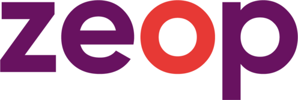
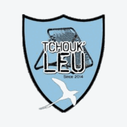
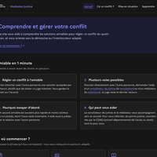
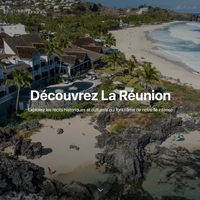

<!-- Bannière -->

  

  

  
  
  
  

  
  
  
  

---

## 💼 Ce que je fais

Je suis **Aurélien Loyer**, développeur **Full-Stack & IA**. Je conçois des outils qui servent à quelqu'un : un agent IA pour les équipes d'un opérateur télécom, une app de gestion pour une association, le site d'un club sportif.

- 🤖 **Aujourd'hui** : en alternance chez **Free**, je construis un **agent IA interne** qui rend la documentation de l'entreprise interrogeable, avec un pipeline RAG qui tourne entièrement en local.
- 🛠️ **Avant** : 6 mois chez **ZEOP**, opérateur télécom réunionnais, à migrer des écrans PHP 3 vers **Laravel / PHP 8**.
- 🌐 **À côté** : je livre des sites et des applications web à des clubs et des associations, de la maquette à la mise en ligne.
- 🎯 **Je cherche** : un **stage de 4 mois à partir d'avril 2027**, en IA appliquée ou en développement full-stack.

  
  &nbsp;&nbsp;&nbsp;&nbsp;&nbsp;&nbsp;
  

---

## 🧰 Ce que je peux livrer

| | Domaine | Concrètement |
|:---:|---|---|
| 🤖 | **Agents IA & RAG** | Base de connaissances interrogeable à partir de PDF et de Word, agents LangGraph, LLM hébergés en local (Ollama, SGLang) pour garder les données en interne. |
| ⚡ | **Applications web & PWA** | React / Next.js + Supabase, temps réel, authentification, paiement (SumUp), installables sur mobile. |
| 🌐 | **Sites vitrines** | Sites rapides et faciles à mettre à jour, déployés sur Vercel avec nom de domaine et DNS configurés. |
| 🔁 | **Modernisation de code** | Reprise d'applications PHP anciennes, migration vers Laravel, correction et ajout de fonctionnalités. |
| ⚙️ | **Automatisation** | Workflows n8n, scripts Python, intégration d'API. |

---

## 🏢 Expérience

| | Période | Poste |
|:---:|---|---|
|  | oct. 2026 → fév. 2027 | **Alternant · Agent IA** @ **Free** Pipeline RAG local sur la documentation interne : parsing structuré, chunking sémantique, embeddings, agent LangGraph. Python · LangGraph · SGLang · Mistral · Ollama · RAG |
|  | sept. 2025 → fév. 2026 | **Stagiaire développeur web** @ **ZEOP** (6 mois) Migration d'écrans applicatifs PHP 3 vers Laravel / PHP 8, ajout de fonctionnalités et corrections. PHP · Laravel · JavaScript · SQL |
| <picture><source media="(prefers-color-scheme: dark)" srcset="assets/epitech-logo.svg" /></picture> | 2024 → 2029 | **Formation** · EPITECH La Réunion, Expert en Technologies de l'Information (Bac +5), actuellement en 3e année |

---

## 🚀 Réalisations

| | Projet | Pour qui / contexte | Ce que j'ai livré | Stack | Liens |
|:---:|---|---|---|---|---|
|  | 🤖 **Agent IA interne** | Free · alternance | Agent qui répond aux questions des équipes à partir de la documentation interne, sans que les données quittent l'entreprise. | Python · LangGraph · Mistral · SGLang | 🔒 Privé |
|  | 🔁 **Migration Laravel** | ZEOP · stage | Écrans de l'opérateur portés de PHP 3 vers Laravel / PHP 8. | PHP · Laravel · SQL | 🔒 Privé |
|  | 🏗️ **BDE Hub** | BDE EPITECH · en production | 3 PWA (vitrine, boutique, admin) sur une base Supabase commune, synchronisées en temps réel, avec paiement SumUp. | React · Supabase · Cloudinary · SumUp | [Démo](https://bdepitech-link.vercel.app/) |
|  | 🏐 **WS Tchoukball Team** | Club des White Sharks | Site officiel du club, contenu administrable. | React · Supabase · Cloudinary | [wstchoukball.com](https://wstchoukball.com) |
|  | 🏐 **Tchouk'Leu** | Club de Saint-Leu | Site officiel : galeries, calendrier, contact. | React | [tchoukleu.re](https://tchoukleu.re) |
| <picture><source media="(prefers-color-scheme: dark)" srcset="assets/epitech-logo.svg" /></picture> | 🖨️ **3D Planner** | Fablab EPITECH | Planning et réservation des imprimantes 3D, synchronisé avec l'API BambuLab. | React · TypeScript · Supabase Realtime | [Démo](https://3d-printer-epitech.vercel.app/?kiosk=1) |
| <picture><source media="(prefers-color-scheme: dark)" srcset="assets/epitech-logo.svg" /></picture> | 🤖 **Buddy** | Hub EPITECH La Réunion | Le robot Buddy devient un guide conversationnel pour les visiteurs. Présenté le 14 juillet à la Préfecture. | Kotlin · Android · Groq · STT/TTS | [Repo](https://github.com/aurelien-loyer-dev/BUDDY-THE-ROBOT) |
|  | 🥇 **Couverture d'antenne** | Hackathon Free · 1re place | App géospatiale : 2 651 antennes à La Réunion et Mayotte, couverture 2D/3D, estimation du signal. | TypeScript · Python · MapLibre · Docker | [Vidéo](https://youtu.be/6jD4o2KlAXg) |
|  | 🥈 **IRIS** | Hackathon Justice Tech · 2e place | Assistante IA locale (RAG) conforme au RGPD pour orienter vers la conciliation et la médiation. | Next.js · Ollama · Docker | — |
|  | 📖 **Zistoire** | Hackathon MACE · hôtellerie | Les clients d'un hôtel scannent un QR code et découvrent l'histoire de La Réunion. | Python · Flask · React | [Repo](https://github.com/aurelien-loyer-dev/zistoire-hackaton-mace) |

  <a href="https://aurelien-loyer.dev"><b>➜ Détails, captures et vidéos sur mon portfolio</b></a>

---

## 🛠️ Stack

**IA & données**

  
  
  
  
  
  
  

**Web & mobile**

  

**Déploiement & outils**

  

---

## 🏆 Distinctions

  
  
  

---

## 📊 Statistiques GitHub

  
  

  

  
  
  

  

  <picture>
    <source media="(prefers-color-scheme: dark)" srcset="https://raw.githubusercontent.com/aurelien-loyer-dev/aurelien-loyer-dev/output/github-contribution-grid-snake-dark.svg" />
    
  </picture>

---

## 🤝 Travailler ensemble

Un stage, une alternance, un projet IA ou web ? Écris-moi, je réponds sous 24 h.

  
  
  
  
  

  

